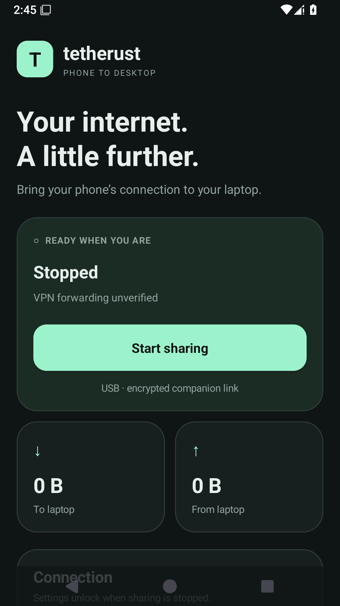

# Tetherust

Native Rust + Slint Android tethering manager for Linux, prioritizing Garuda/Arch and Sway/Wayland. **Development release:** share Android internet through a signed companion over authenticated USB, with optional full-system routing on Linux. Physical companion pairing and internet probes succeeded on an RMX3430; VPN compatibility and cross-distribution support remain subject to the limitations below. See [TEST_RESULTS.md](TEST_RESULTS.md) for actual evidence.



## Run

Download the APK and Linux packages from [GitHub Releases](https://github.com/belalhushelmy2-cmyk/tetherust/releases/latest). Local artifacts are in `dist/` after packaging. End users do not need Cargo. The local build targets this Arch host's glibc; it is not a verified cross-distribution release.

```sh
./dist/Tetherust-0.3.0-x86_64.AppImage
# If FUSE is unavailable:
APPIMAGE_EXTRACT_AND_RUN=1 ./dist/Tetherust-0.3.0-x86_64.AppImage
```

Run as your ordinary user. NetworkManager and a desktop Polkit agent must be running. Use `SLINT_SCALE_FACTOR=1` if XWayland starts the interface too large for a tiled window. `TETHERUST_ADB_DISABLED=1` disables phone inventory/actions, Wi-Fi discovery and companion connections for laptop-only runs.

## Share the phone's existing VPN / internet

The intended path is **Linux apps → Linux TUN → authenticated USB/Wi-Fi channel → companion sockets → Android's app-default network → applicable phone VPN → internet**. No VPN credentials are imported into Linux. The companion never creates a VpnService, requests a cellular underlay, calls protect(), or changes phone-wide VPN settings. Network-specific sockets and DNS use the network Android assigns to this app; the old cellular-only 0.2.0 behavior is replaced.

Manual first setup, when you choose to operate your phone:

1. Install `dist/Tetherust-Companion-0.3.0.apk` yourself. Open it, select **Phone’s current connection**, and tap **Start sharing**. Include `org.tetherust.companion` in your VPN's allowed apps if using split inclusion/exclusion. Keep your existing VPN app responsible for its connection.
2. Connect a USB data cable, authorize USB debugging, select the phone in Devices, then **Pair phone**. Install, Pair and Connect are explicit actions. No native USB tethering toggle is needed. Update both the Linux client and APK for protocol 2.
3. Save **Full-Tunnel** in Settings, then Connect. Without it, the local authenticated proxy does not route all applications.
4. For strict sharing, also enable **Require Phone VPN** and **Kill Switch**, and install the root-owned Linux helper described below. A successful internet probe alone is not proof of VPN routing.

The gateway captures the app-default Android Network for each session, including the VPN when it applies. On a network/capability/route/DNS change it closes existing TCP/UDP sessions. Every new stream carries a network-generation lease and strict-policy flag; stale or inapplicable paths are rejected. Android socket factories cease working when their network disappears, rather than intentionally falling back to a cellular network.

The desktop independently requests an HTTPS exit probe from the phone, then sends its own HTTPS request through forwarding, and requires the two probe IPs to match. Strict mode additionally requires an applicable VPN and default IPv4 VPN routes, pins that network generation and observed exit IP, and refuses automatic trust of a changed path. IPv6 destinations are refused in strict mode unless the VPN has default IPv6 routes. Phone status is polled once per second; exit verification repeats every 15 seconds. A probe can take up to 30 seconds, and that interval is not an instantaneous exit-change guarantee. VPN-internal routing rules and split routing cannot be universally inspected: matching IPs verify the probe, not every application/destination or all DNS/IPv6 leaks. A VPN icon, another app's working browser, or the mere presence of a VPN is insufficient evidence.

### Kill Switch and recovery

This optional Linux guard uses a small **root-owned** `tetherust-netguard` executable authorized through Polkit. The GUI always remains unprivileged. The helper accepts only `enable` / `disable` and fixed nftables rules; no supplied scripts, rule text or arbitrary paths. DEB/Arch system packages install it. With the tar package or AppImage, install the included helper explicitly (example from an extracted tar bundle):

```sh
sudo install -Dm755 lib/tetherust/tetherust-netguard /usr/local/lib/tetherust/tetherust-netguard
# Garuda also needs nftables installed and a running session Polkit agent.
```

The guard blocks host-originated IPv4/IPv6 internet output outside `tetherust0`, including existing connections. Loopback, RFC1918/link-local/ULA destinations and necessary IPv6 neighbor discovery remain allowed. TCP/UDP DNS and DNS-over-TLS ports 53/853 outside the TUN are blocked before LAN exceptions. These are intentional LAN exceptions, not an absolute isolation boundary against LAN proxies or arbitrary encrypted DNS to local services. Other firewall rules can impose additional restrictions; no existing tables are flushed.

The guard is enabled before the companion connection is attempted and stays across failures, USB loss, reconnect attempts and GUI crashes. **Disconnect** (or normal exit) authorizes removal. If recovery fails or the GUI was killed, use:

```sh
tetherust guard-off
# Emergency explicit administrator recovery, deleting only this application's table:
sudo nft delete table inet tetherust_guard
```

An authorization timeout may leave recovery necessary. A root-owned runtime marker makes a surviving guard visible after restart. There is no automatic privileged install or firewall activation during app startup, discovery, packaging or tests on the live host.

### Local proxies and Wi-Fi

For a VPN application that exposes an explicit local HTTP CONNECT or SOCKS5 endpoint, select that mode in the Android companion and enter its loopback port. This supports TCP, including remote hostname resolution by the proxy; it never retries directly if the proxy fails. Only no-auth loopback proxy endpoints are currently supported. **UDP is unavailable in this mode**, and it cannot satisfy Require Phone VPN because the companion cannot verify that proxy's internal VPN state. Ordinary Full-Tunnel TCP applications can still use it; applications requiring UDP will fail or use their own TCP fallback.

Optional Wi-Fi uses the same pinned TLS/token channel. First pair the phone identity over trusted USB. While stopped, enable **Allow encrypted Wi-Fi sharing** on Android, restart sharing, then use **Find Wi-Fi phone** in Devices or `tetherust phone discover-wifi` (requires Avahi tools). Enter a reachable private LAN `IP:38473` in Settings, Save and select the paired identity. Clear the endpoint for USB. Discovery advertisements are untrusted; they never establish pairing. The listener stays loopback-only unless Wi-Fi is explicitly enabled. Hotspot/Wi-Fi Direct reachability and VPN LAN restrictions depend on the device: join/create that link in system settings first. Discovery is not guaranteed on every hotspot; a manual IPv4 LAN endpoint is supported. Actual Wi-Fi/hotspot/Direct acceptance remains untested.

### Native Android USB tethering (separate compatibility mode)

Native tethering can be selected as a network interface without the companion, but it does **not** demonstrate use of the phone VPN. It is rejected when Require Phone VPN or Kill Switch is selected. It uses temporary NetworkManager profiles/checkpoints and restores them on Disconnect. Default native mode has high-metric fallback routes; Full-Tunnel requests preferred routes. VPN policies and IPv6 can still override native preference. Existing desktop-established Wi-Fi/PAN links can be observed without taking ownership of their routes.

The companion TUN is user-owned and volatile, with a dedicated D-Bus lifetime; it carries TCP/compatible UDP and virtual DNS without replacing global resolv.conf. Abrupt crashes release its routes, while the separately enabled firewall guard persists until explicit recovery. An abrupt crash can leave an authenticated ADB forward until the phone/ADB server disconnects. Hide to tray requires a StatusNotifierItem host such as Waybar; closing the window quits and performs normal cleanup.

## CLI

```sh
tetherust doctor
tetherust devices
tetherust devices --json
tetherust connect --interface usb0                 # Ctrl+C restores changes
tetherust connect --interface usb0 --full-system   # explicit route/DNS preference
tetherust verify usb0                              # no network changes
tetherust probe-proxy wlp3s0 --port 8000            # explicit gateway HTTP CONNECT diagnostic
tetherust history
tetherust phone devices
tetherust phone pair SERIAL
tetherust phone connect SERIAL --full-system
# Explicit strict session, after installing the root-owned helper:
tetherust phone connect SERIAL --full-system --require-phone-vpn --kill-switch
# Optional paired Wi-Fi endpoint:
tetherust phone connect SERIAL --full-system --wifi-endpoint 192.168.1.2:38473
tetherust phone discover-wifi
tetherust guard-off
# Optional explicit install; the app does not run this automatically:
tetherust phone install SERIAL /path/to/Tetherust-Companion-0.3.0.apk
```

Multiple USB candidates require explicit selection. An existing desktop-established Wi-Fi/PAN link can be selected with `connect --interface NAME`; it is monitored without taking ownership of its routes, and Disconnect ends observation. Pair Bluetooth/enable PAN or join the phone's Wi-Fi link through desktop settings first. A proxy probe reports standard TCP CONNECT compatibility; it does not route every application and does not carry arbitrary UDP. There is no simulated full-system proxy mode.

Settings store a selected interface profile, reconnect/auto-connect, notification and route preferences. Auto-connect defaults off and only selects a unique supported USB candidate. Disconnect suppresses auto-connect until settings are applied again or the app restarts. Session counters use kernel interface statistics and include unrelated/local traffic on that interface. Verification latency includes DNS and TLS; it is not ICMP ping. Public IP is retrieved from Cloudflare's HTTPS trace endpoint, which necessarily sees the probe connection. Health checks repeat every 15 seconds while a session runs.

Logs show fixed event labels or local advanced diagnostics; Copy/Export always redact network identifiers. Copy needs optional wl-clipboard (Wayland) or xclip (X11). Export writes a new private file in the app data directory and shows its path. Settings/history live under the XDG data directory, normally `~/.local/share/tetherust/`. Startup is a per-user `~/.config/autostart/tetherust.desktop`. Disabling Startup removes that entry. Uninstalling never deletes personal history/config automatically.

## Build and verify

Rust 1.92+, development headers for Fontconfig, XKB, X11 and Wayland, pkg-config and a C toolchain. NetworkManager is required at runtime. The GUI uses Slint's GPL-compatible open-source licensing under this project's GPL-3.0-only license; dependency licenses also apply.

```sh
cargo build --release --locked
TETHERUST_ADB_DISABLED=1 cargo test --locked --all-targets
# Uses an isolated fake NetworkManager on a private bus, never the real system bus:
TETHERUST_ADB_DISABLED=1 dbus-run-session -- cargo test --locked --test network_bus -- --ignored
cargo fmt --check
cargo clippy --locked --all-targets -- -D warnings
cargo run --locked -- doctor
cargo run --locked -- gui --snapshot /tmp/tetherust.png
scripts/package.sh
# Development-only UI/package harnesses require Python, Sway, grim, wl-clipboard,
# a C compiler and wayland-scanner; none are required by the installed application:
python3 tests/native_sway.py
python3 tests/packages.py
```

CLI-only: `cargo build --release --locked --no-default-features`. It has no Slint/tray dependencies in the resulting executable. No Python, Electron, Chromium, WebView or root GUI is required. Companion USB uses packaged/system ADB; Wi-Fi discovery optionally uses Avahi.

See [docs/RESEARCH.md](docs/RESEARCH.md), [ARCHITECTURE.md](ARCHITECTURE.md), [PROGRESS.md](PROGRESS.md), and [docs/HARDWARE_ACCEPTANCE.md](docs/HARDWARE_ACCEPTANCE.md). Physical companion pairing and matching phone/forwarded HTTPS probes passed on an RMX3430 after the EC TLS identity fix. The user reported working sharing. Controlled phone VPN/split-proxy, USB interruption, Wi-Fi, sustained performance and cross-distribution acceptance remain pending.
